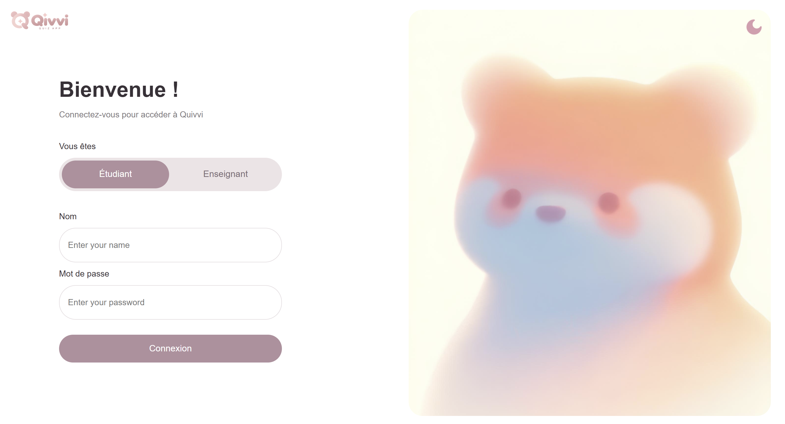
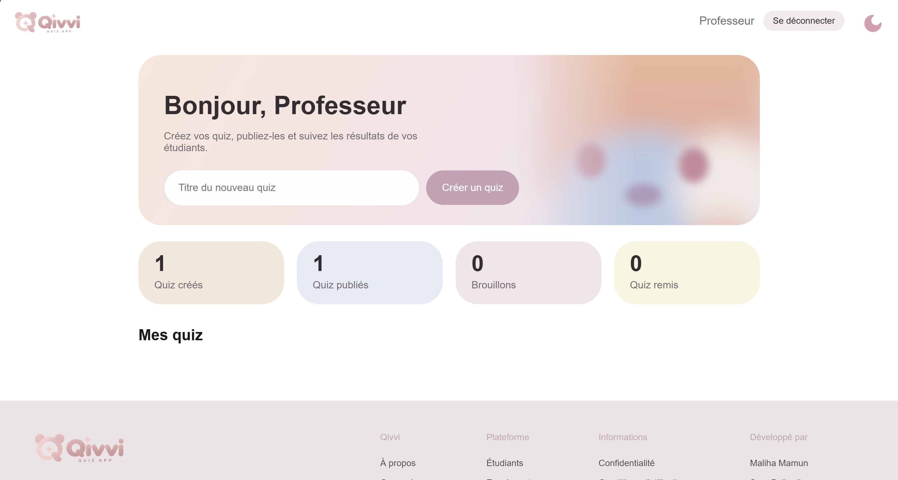

# Qivvi – Quiz App

Qivvi est une application web de quiz qui permet aux enseignants de créer et de gérer des quiz, et aux étudiants d'y répondre.

Ce projet est réalisé en équipe dans le cadre du cours **Méthodes Agiles** au Collège Ahuntsic.

Pour y accéder, cliquer ici : https://qivvi.freehosting.dev

## Screenshots

### Login Page


### Dashboard



## Fonctionnalités

### Disponibles

- **Connexion** avec choix du rôle (étudiant ou enseignant), validation des champs et messages d'erreur
- **Session utilisateur** : les pages protégées redirigent vers la connexion, bouton « Se déconnecter »
- **Mots de passe hachés** dans la base de données (`password_hash` / `password_verify`)
- **Changement de mot de passe** :
  - depuis la page de connexion (`reinitialiser.php`), avec le nom d'utilisateur et l'ancien mot de passe
  - une fois connecté (`mdp.php`), avec l'ancien mot de passe
- **Tableau de bord enseignant** (`index.php`) : cartes de statistiques et liste des quiz de l'enseignant
- **Création d'un quiz** (`quiz.php`) : titre, description, puis ajout de questions
- **Questions** à choix multiple ou vrai/faux, avec 2 à 5 réponses et sélection de la ou des bonnes réponses
- **Enregistrement** du quiz, de ses questions et de ses réponses en une seule transaction (`includes/api.php`)
- **Aperçu d'un quiz** (`appercuQuiz.php`) : affichage des questions et de leurs réponses
- **Mode clair / sombre**, conservé pendant toute la session
- **Quiz de test** : `test-quiz.php` permet de répondre au « Quiz test » et `corriger.php` calcule le score

### Prévues

- Accès des étudiants aux quiz publiés
- Consultation des résultats par les étudiants et par les enseignants

## Technologies utilisées

- **HTML** : structure des pages
- **CSS** : mise en page, design et mode sombre
- **JavaScript** : interactions, formulaire de questions, appels à l'API et mode sombre
- **PHP** : traitement côté serveur (PDO)
- **MariaDB / MySQL** : base de données
- **XAMPP** : environnement de développement local
- **Git et GitHub** : gestion des versions et collaboration

## Structure du projet

```text
Projet_Methodes_Agiles_Quiz/
├── index.php            Tableau de bord et liste des quiz
├── login.php            Page de connexion
├── logout.php           Déconnexion
├── quiz.php             Création d'un quiz et ajout de questions
├── appercuQuiz.php      Aperçu d'un quiz
├── reinitialiser.php    Changement de mot de passe (depuis la connexion)
├── mdp.php              Changement de mot de passe (utilisateur connecté)
├── test-quiz.php        Répondre au quiz de test
├── corriger.php         Correction et score du quiz de test
├── init.php             Création des tables et des données de test
├── includes/
│   ├── api.php          API d'enregistrement d'un quiz complet (JSON)
│   ├── auth.php         Gestion de la session et des pages protégées
│   ├── validations.php  Validation du formulaire de connexion
│   ├── db.php           Connexion à la base de données
│   ├── error.php        Page d'erreur
│   ├── header.php       En-tête commun
│   └── footer.php       Pied de page commun
├── js/script.js         Scripts de l'application
├── css/styles.css       Styles de l'application
└── images/              Logo, icônes, captures d'écran
```

## Base de données

La base `quizbd` contient quatre tables, créées par `init.php` :

| Table | Colonnes principales | Relation |
| --- | --- | --- |
| `users` | `username`, `password` (haché), `role` (`etudiant` ou `enseignant`) | — |
| `quiz` | `titre`, `description`, `user_id` | un enseignant a plusieurs quiz |
| `questions` | `enonce`, `type` (`choix_multiple` ou `vrai_faux`), `quiz_id` | un quiz a plusieurs questions |
| `reponses` | `texte`, `est_correcte`, `question_id` | une question a plusieurs réponses |

La suppression d'un quiz supprime ses questions, et la suppression d'une question supprime ses réponses (`ON DELETE CASCADE`).

## Installation

1. Cloner le dépôt GitHub :

   ```bash
   git clone https://github.com/yasminagabriela/Projet_Methodes_Agiles_Quiz.git
   ```

2. Placer le projet dans le dossier `htdocs` de XAMPP.

3. Démarrer **Apache** et **MySQL** dans XAMPP.

4. Créer une base de données vide nommée `quizbd` (par exemple dans phpMyAdmin).

   Par défaut, `includes/db.php` se connecte à `localhost` avec l'utilisateur `root` sans mot de passe. Pour utiliser la base en ligne, créer le fichier `includes/db_online.php` (ignoré par Git) qui redéfinit `$serveur`, `$baseDeDonnees`, `$utilisateur` et `$motDePasse`.

5. Initialiser les tables et les données de test en ouvrant :

   ```text
   http://localhost/Projet_Methodes_Agiles_Quiz/init.php
   ```

6. Ouvrir l'application dans un navigateur :

   ```text
   http://localhost/Projet_Methodes_Agiles_Quiz/
   ```

### Compte de test

`init.php` crée un compte enseignant et un quiz de test :

| Nom d'utilisateur | Mot de passe | Rôle |
| --- | --- | --- |
| `Farid` | `Farid` | enseignant |

## Organisation du projet

Le développement est organisé en sprints selon la méthode Scrum.

- **Sprint 01** : connexion de l'enseignant (base de données, page de connexion, authentification, session, tableau de bord)
- **Sprint 02** : création d'un quiz (tables quiz, questions et réponses, interface de création, API, aperçu)

Les tâches sont réparties entre les membres de l'équipe à l'aide des **Issues GitHub**, regroupées par sprint. Les modifications sont intégrées à la branche principale à l'aide de **Pull Requests** ou de fusions.

## Équipe

- Maliha Mamun
- Sara Belhadj
- Talyssa Lydie Lacombe
- Yasmina Cabrera
- Jaynelle Latortue-Raymond

## État du projet

Projet en cours de développement. La connexion et la création de quiz par l'enseignant sont fonctionnelles ; l'espace étudiant et la consultation des résultats restent à faire.
