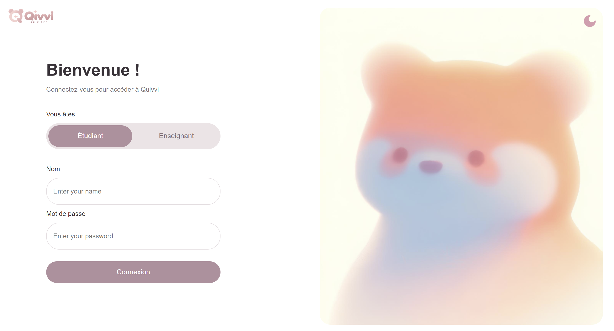

# Qivvi – Quiz App

Qivvi est une application web de quiz qui permet aux enseignants de créer et de gérer des quiz, et aux étudiants d'y répondre.

Ce projet est réalisé en équipe dans le cadre du cours **Méthodes Agiles** au Collège Ahuntsic.

## Screenshots

### Login Page


### Dashboard
<!--  -->


## Fonctionnalités

### Enseignants
- Se connecter à l'application
- Accéder à un tableau de bord
- Créer et publier des quiz
- Consulter les résultats des étudiants

### Étudiants
- Se connecter à l'application
- Accéder aux quiz disponibles
- Répondre aux questions
- Consulter leurs résultats

## Technologies utilisées

- **HTML** : structure des pages
- **CSS** : mise en page et design
- **JavaScript** : interactions et mode sombre
- **PHP** : traitement côté serveur
- **MariaDB / MySQL** : base de données
- **XAMPP** : environnement de développement local
- **Git et GitHub** : gestion des versions et collaboration

## Installation

1. Cloner le dépôt GitHub :

   ```bash
   git clone URL_DU_DEPOT
   ```

2. Placer le projet dans le dossier `htdocs` de XAMPP.

3. Démarrer **Apache** et **MySQL** dans XAMPP.

4. Configurer la connexion à la base de données dans le fichier prévu à cet effet.

5. Initialiser la base de données selon les scripts du projet.

6. Ouvrir l'application dans un navigateur :

   ```text
   http://localhost/Projet_Methodes_Agiles_Quiz/
   ```

## Organisation du projet

Le développement est organisé en sprints selon la méthode Scrum.

Les tâches sont réparties entre les membres de l'équipe à l'aide des **Issues GitHub**. Les modifications sont réalisées sur des branches, puis intégrées à la branche principale à l'aide de **Pull Requests**.

## Équipe

- Maliha Mamun
- Sara Belhadj
- Talyssa Lydie Lacombe
- Yasmina Cabrera
- Jaynelle Latortue-Raymond

## État du projet

Projet en cours de développement. Certaines fonctionnalités peuvent encore être en cours d'intégration ou de test.
